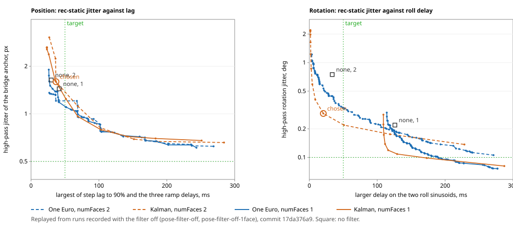

# Head-pose filter

Two temporal filters for the solved head pose, compared by measurement: a One Euro filter and an error-state Kalman filter, both on SE(3) ([`packages/cv/src/filter/`](../packages/cv/src/filter/)). The app filters each trusted pose and predicts it to the frame on screen at every render ([`frontend/src/filtering/overlayPose.ts`](../frontend/src/filtering/overlayPose.ts)). Numbers come from `runs["pose-filter-sweep"]`, `runs["pose-filter"]` and the filter-off runs in [`eval/results.json`](../eval/results.json).

## Shared interface

`update(pose, t)` filters a pose measured at capture time $t$ and returns the estimate at $t$; `predict(t)` extrapolates it at constant velocity, clamped to $[t_\text{last}, t_\text{last} + 100\,\text{ms}]$; `reset()` drops the state. A gap over 200 ms or a non-increasing timestamp restarts the filter from the new pose: past six frames at 30 Hz the velocity is stale, and a restart has no lag. Rotations are unit quaternions differenced through the log map, which returns the shorter arc whatever the signs, so the sign flip `quaternionFromMatrix` makes where the rotation angle passes $\pi$ never reaches the filter.

## One Euro on SE(3)

With $\Delta t$ the time since the last update, a first-order low-pass with cutoff $f$ has the smoothing factor

$$\alpha(f, \Delta t) = \frac{\Delta t}{\Delta t + \tau}, \qquad \tau = \frac{1}{2\pi f},$$

exact for any $\Delta t$. Rotation (Casiez et al., CHI 2012, on the tangent space):

$$\omega_k = \frac{\log(q_k q_{k-1}^{-1})}{\Delta t}, \quad \hat\omega_k = \hat\omega_{k-1} + \alpha(f_d)\,(\omega_k - \hat\omega_{k-1}), \quad f_c = f_\text{min} + \beta \lVert\hat\omega_k\rVert,$$

$$\hat q_k = \exp\!\big(\alpha(f_c)\,\log(q_k \hat q_{k-1}^{-1})\big)\,\hat q_{k-1},$$

a slerp from $\hat q_{k-1}$ toward $q_k$. Each translation axis is its own One Euro filter with $|\hat v|$ in mm/s. `predict` returns $\exp(\hat\omega h)\,\hat q$ and $\hat p + \hat v h$.

At constant velocity the cutoff settles and the filter trails by exactly $\tau(f_c)$ for any frame interval: the lag $e$ obeys $e \leftarrow (1-\alpha)(e + v\Delta t)$, whose fixed point is $v\tau$. Extrapolating with $\hat v$ moves the estimate forward but leaves that lag. The tests check both, the noise gain $\sqrt{\alpha/(2-\alpha)}$ at rest, and the step response $1 - (1-\alpha)^n$.

## Error-state Kalman filter on SE(3)

Nominal state: rotation $q$, angular velocity $\omega$ in the camera frame, translation $p$, velocity $v$. Error state $\delta x = (\delta\theta, \delta\omega, \delta p, \delta v) \in \mathbb{R}^{12}$ with the rotation error on the tangent space as a left perturbation, $q_\text{true} = \exp(\delta\theta)\,q$.

**Process.** Constant velocity: $q \leftarrow \exp(\omega\Delta t)\,q$, $p \leftarrow p + v\Delta t$. The error moves as

$$F_\text{rot} = \begin{bmatrix} R(\omega\Delta t) & J_l(\omega\Delta t)\,\Delta t \\ 0 & I \end{bmatrix}, \qquad F_\text{trans} = \begin{bmatrix} I & I\Delta t \\ 0 & I \end{bmatrix},$$

with $R$ the rotation of $\omega\Delta t$ and $J_l$ the left Jacobian of SO(3), $\exp(\phi + d) \approx \exp(J_l(\phi)\,d)\exp(\phi)$. White acceleration of spectral density $q_c$ gives, per axis,

$$Q = q_c \begin{bmatrix} \Delta t^3/3 & \Delta t^2/2 \\ \Delta t^2/2 & \Delta t \end{bmatrix},$$

with $q_c = \sigma_\alpha^2$ for rotation and $\sigma_a^2$ for translation. Rotation and translation never mix, so the covariance is two $6 \times 6$ blocks.

**Measurement.** A solved pose $(q_m, p_m)$ gives the innovation $y = \big(\log(q_m q^{-1}),\; p_m - p\big)$ with $H = [I\;0]$ per block and $R = \operatorname{diag}(\sigma_\theta^2 I_3,\ \sigma_x^2, \sigma_y^2, \sigma_z^2)$. The update is the standard $K = PH^\top(HPH^\top + R)^{-1}$ with the covariance in Joseph form. The correction is folded into the nominal state, $q \leftarrow \exp(\delta\hat\theta)\,q$, and the rotation block is mapped to the new nominal rotation by $J_l(\delta\hat\theta)$. The measurement noise comes from the solved poses on rec-static: the RMS distance from a five-sample moving average, times $\sqrt{5/4}$ for the variance the average removes (`solvedPoseNoise` in the sweep). Only $\sigma_\alpha$ and $\sigma_a$ are swept.

The model matches constant-velocity motion, so the posterior and its prediction converge to the truth there: zero steady-state error, which the tests check under fixed and variable $\Delta t$. A step makes it overshoot, because the velocity it picks up while catching up carries it past. The tests also check the error transition against finite differences and the response at rest and on a step against an independent two-state filter at its steady-state gain.

## Timing in the app

Inference runs at camera rate (about 30 Hz) and rendering at display rate (60 Hz in the harness). Each trusted pose updates the filter at its frame's capture time. A frame without a face resets it; a gated frame does not, and the gap rule restarts the filter when the overlay was hidden longer than 200 ms. Each render predicts to the capture time of the newest frame the video has presented, which `requestVideoFrameCallback` reports before the render runs. That frame is what the overlay is composited over, and its landmarks are still in the worker for about one render, so the prediction covers the inference latency. Predicting to the render's own clock would put the overlay a render ahead of the video on every other render whenever the head moves. `VITE_POSE_FILTER` (`one-euro`, `kalman` or `off`) selects the filter at build time; the harness records with `off`.

## Measurement

**Clips.** Besides the still and recorded clips, three motion clips move the first frame of `static.mp4` by a known amount in every frame (`MOTION` in [`eval/harness/conditions.mjs`](../eval/harness/conditions.mjs)): `step-x` jumps 80 px right and back every second, `ramp-x` moves at 240 px/s between -120 and +120 px, and `sine-roll` rolls 10 degrees with a 2 s period. Chrome's fake camera timestamps frames with timer jitter, so the frame callback's `mediaTime` alone picks the wrong clip frame for a share of frames (`mediaTimeMismatchShare` per motion clip). Each clip frame therefore carries its index as eight black or white squares in the top-left corner; the harness reads them in its own frame callback and joins them to the app's capture events by `mediaTime`, which both callbacks see for the same frame.

**Metrics.** Jitter is the RMS distance from a centred moving average over about 150 ms of what each render drew on rec-static, blinks masked. Lag is measured against the frame on screen at each render: on the step, the time from the first frame showing the step to the first render at 90% of it (median over the steps, which the 60 Hz renders quantize to about 17 ms); on the ramp and the sinusoid, the phase lag of the clip's fundamental, where the cross-correlation peaks for a pure delay. The position lag is the larger of the step and ramp lags, since a filter tuned on the step alone can jump fast and still crawl at moderate speed, and the 50 ms target for the step applies to the ramp and roll delays too. Without any filter the step lag is one render: the first render after the step frame appears still has the old pose, because that frame's landmarks are in the worker.

**Sweep.** A harness run per parameter set is too slow for hundreds of points, so the sweep replays two runs recorded with the filter off, one per MediaPipe configuration (`numFaces` 1 and 2), through the same filter code offline ([`poseReplay.mjs`](../eval/harness/poseReplay.mjs)): each shown pose sample updates the filter at its capture time, a lost face resets it, and each recorded render predicts to the newest presented frame. The warmup's events run first. Without a filter the replay reproduces every recorded render (`replayErrorPx`). Rotation parameters are swept first against rotation jitter and the roll delay, then translation parameters with the chosen rotation against position jitter and position lag ([`poseFilterSweep.mjs`](../eval/harness/poseFilterSweep.mjs)). In each stage the operating point is the least jitter among points with a lag under 50 ms. The live run with the chosen filter (`runs["pose-filter"]`) then checks the replay's prediction.

Each curve is the Pareto front of one filter's sweep on one MediaPipe configuration; the squares are the unfiltered pose. Regenerate with `node eval/harness/plotPoseFilter.mjs`.

## Results

| | `pose-integration` | `pose-filter-off` | `pose-filter` | Replay | Target |
|---|---|---|---|---|---|
| Position jitter, rendered (px) | - | 1.43 | 0.95 | 0.96 | at most 0.5 |
| Position jitter, per frame (px) | 1.47 | 1.49 | 0.76 | - |  |
| Rotation jitter, rendered (deg) | - | 0.251 | 0.150 | 0.166 | at most 0.1 |
| Rotation jitter, per frame (deg) | 0.220 | 0.266 | 0.141 | - |  |
| Step lag to 90%, median / max (ms) | - | 16.7 / 36.1 | 35.4 / 69.2 | 35.6 / 36.1 | under 50 |
| Step overshoot, median (%) | - | 0.5 | 8.6 | 8.4 |  |
| Ramp delay (ms) | - | 20.9 | 49.5 | 49.5 | under 50 |
| Roll delay (ms) | - | 41.7 | 45.8 | 45.7 | under 50 |
| Blink shift, median (px) | 4.16 | 4.16 | 4.78 | 4.76 |  |
| Gated share, still and recorded clips | 0.000 | 0.000 | 0.000 | - |  |

`pose-integration` is the last run before filtering, `pose-filter-off` this branch with the filter off, `pose-filter` the chosen filter live, and Replay the sweep's value for the same point. Apple M4 Pro, HeadlessChrome 158.0.0.0, GPU delegate, 1280x720 at 60 Hz rendering; rec-static is 10 s (553 renders, 277 pose samples, 1 blink masked), each motion clip 8 s with 8 steps on step-x. Per-frame jitter is the filtered pose at each frame's capture time, the quantity `pose-integration` measured; rendered jitter is what the screen shows.

**Choice.** The One Euro filter with rotation $f_\text{min}$ = 0.02 Hz, $\beta$ = 30 Hz per rad/s, $f_d$ = 1 Hz, and translation $f_\text{min}$ = 0.02 Hz, $\beta$ = 0.03 Hz per mm/s, $f_d$ = 2 Hz (`ONE_EURO_OPTIONS`). Among the operating points of both filters and both MediaPipe configurations it is the one with both lags under 50 ms and the smallest worst ratio of jitter to target (`recommended` in the sweep). It meets the step lag target and neither jitter target. The curves show what the targets cost: the One Euro front reaches 0.49 px at 136 ms of position lag and 0.100 degrees at 86 ms of roll delay. The Kalman filter does better on rotation, 0.131 degrees at 35 ms of roll delay and 0.103 at 54 ms, since the roll is smooth and its model predicts it. On position it barely smooths within 50 ms (1.42 px) and overshoots the step by 37%, so it loses overall. The One Euro point overshoots the step by about 8%: after a jump the speed estimate is large and the prediction carries the overlay past.

The live run matches the replay except for rotation jitter, 0.150 against 0.166 degrees, which also varies between runs without a filter (per frame, 0.220 in `pose-integration` and 0.266 in `pose-filter-off`). One of the eight live steps took 69 ms to reach 90%; the median is 35 ms.

**Limits.** The motion clips move one recorded frame in the image plane: translation along x and roll about the viewing axis. They give the filter known motion but cover neither yaw, pitch nor depth, nor how the landmark model responds to a real moving face. rec-static is one recording of one person, and its high-pass jitter includes any real head motion above a few hertz. The replay reproduces the unfiltered renders exactly, but landmark noise differs from run to run, so the live and replayed values of the chosen point differ by that much.

## MediaPipe's landmark filter

With `numFaces` 1, FaceLandmarker smooths landmarks with its own One Euro filter before the solver sees them, and with 2 it does not ([perception README](../frontend/src/perception/README.md)). Our filter stacks on top of it either way.

Measured with the filter off (`runs["pose-filter-off"]` and `runs["pose-filter-off-2faces"]`, rendered over 10 s of rec-static and 8 s of each motion clip), and the operating points of the sweep with each configuration:

| | `numFaces` 1 | `numFaces` 2 |
|---|---|---|
| Landmark 168 jitter, still (px) | 0.010 | 0.288 |
| Landmark 168 jitter, rec-static (px) | 1.46 | 1.58 |
| Solved rotation jitter, rec-static (deg) | 0.266 | 0.790 |
| Landmark lag on the step (ms) | 0.0 | 0.0 |
| Landmark 168 delay on the ramp (ms) | 3.2 | -0.1 |
| Eye-line delay on the roll (ms) | 26.0 | 0.3 |
| Inference p50 on the still clip (ms) | 12.1 | 16.0 |
| One Euro operating point: position (px) / rotation (deg) | 0.96 / 0.166 | 1.09 / 0.274 |
| Kalman operating point: position (px) / rotation (deg) | 1.42 / 0.131 | 1.62 / 0.217 |

**Recommendation: keep `numFaces` 1.** MediaPipe's filter delays the landmarks by 26 ms on the roll and 3 ms on the ramp, and not measurably on the step. It also removes most of the landmark noise that drives rotation; without it the solved rotation on rec-static is about three times noisier. Our filter cannot win that back within the lag target; with two faces both filters' operating points are worse on both axes. Two faces also run the face detector on every frame, which raised median inference on the still clip from 12.1 to 16.0 ms.
